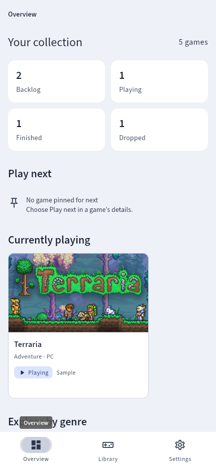
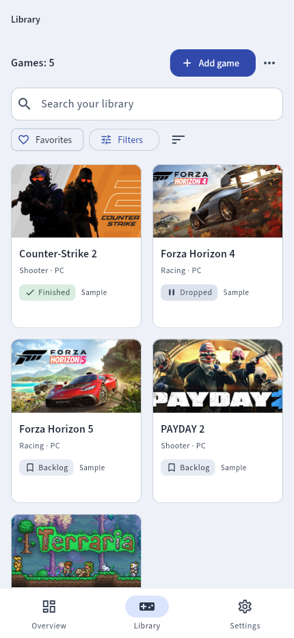
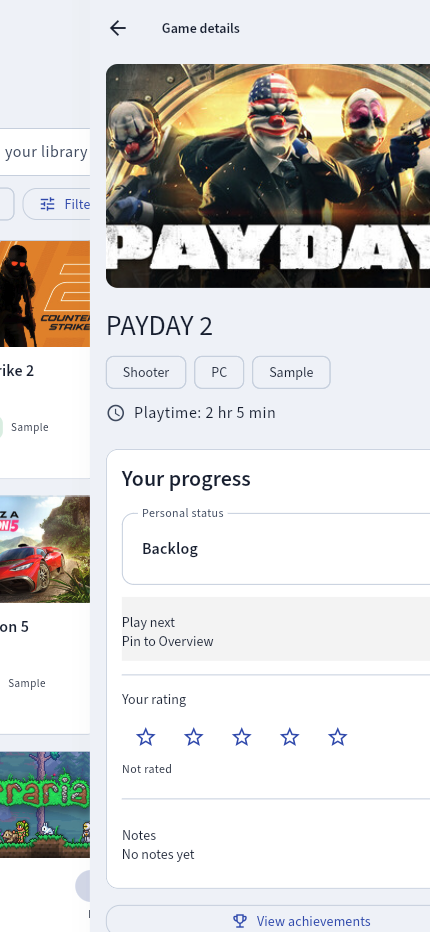
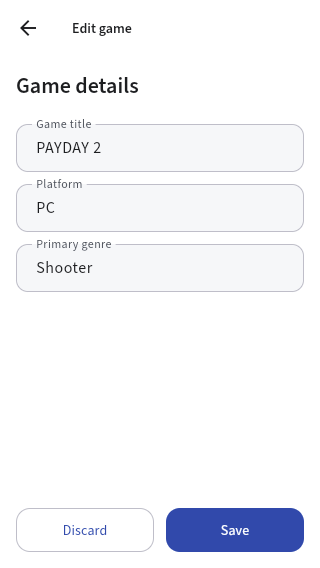
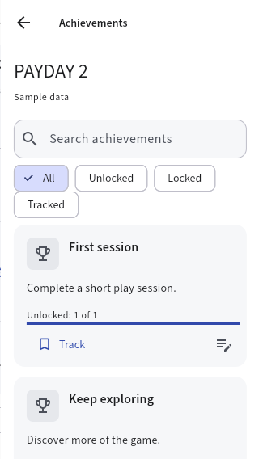
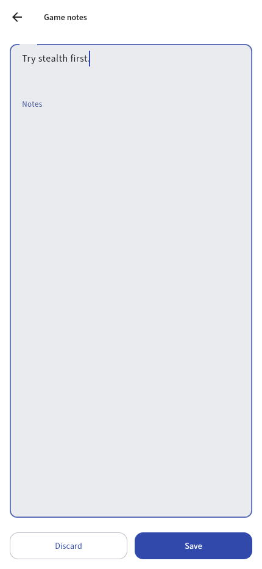
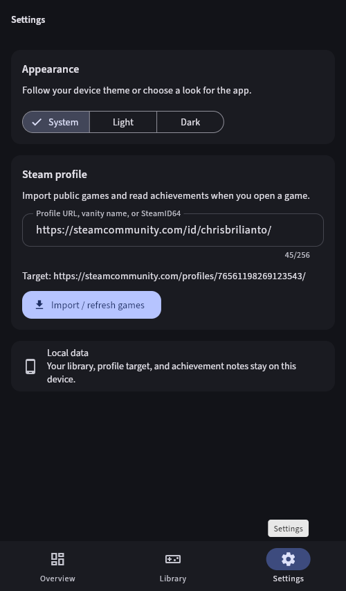

# Game Backlog

Game Backlog is a Flutter coursework app for organizing a personal game library and working toward Steam achievements. Local game details, ratings, favorites, achievement tracking, and notes are stored with SQLite through Drift. A public Steam profile can be selected in Settings to import visible games and read achievement progress on demand.

## Features

- Overview with genre bubbles and library counts
- Library search, filters, sorting, favorites, and game details
- Automatic Steam covers, with an optional cover URL for manual games
- Personal status, rating, play-next, and notes for each game
- Steam profile import and playtime through the local Worker
- On-demand achievement definitions and unlock state, with tracking, notes, filters, and guide links
- Dark, light, and system appearance
- Development emulator and retained H2 media demonstrations

## Requirements

- Flutter SDK with Dart 3.13.3 or a compatible newer version
- Chrome for the web version, or an Android device/emulator for Android
- For Steam profile import: Node.js/npm, a Steam Web API key, and the local Cloudflare Worker

## Run the app

```sh
flutter pub get
flutter run
```

For Chrome:

```sh
flutter run -d chrome
```

## Enable Steam import

Steam import needs the local Cloudflare Worker and a Steam Web API key. Keep the key in `workers/steam-guides/.dev.vars`; do not put it in Flutter code or the browser.

```sh
cd workers/steam-guides
npx wrangler@4 dev --ip 127.0.0.1 --port 8787
```

In a second terminal, run Flutter with the local Worker URL:

```sh
flutter run -d chrome --dart-define=STEAM_GUIDE_API_BASE_URL=http://127.0.0.1:8787
```

Open Settings, enter a public Steam profile URL, vanity name, or SteamID64, and select **Import / refresh games**. Imported games appear in Library. Open a game and choose **View achievements**. The app reads Steam when asked; changes are not live-pushed. The hosted Worker is `https://game-backlog-steam-guides.steam-guides.workers.dev`. Public profile data does not verify account ownership.

The app connects to the hosted Steam service automatically. Settings only needs your Steam profile. The API key stays on the Worker. Developers can override the service with `STEAM_GUIDE_API_BASE_URL` when running or building the app.

If Steam cannot refresh achievements, the app labels saved results and offers Retry. Game covers load automatically for existing Steam imports. Add or edit a manual game to enter its HTTPS cover image URL.

## Android release

```sh
flutter build apk --release --dart-define=STEAM_GUIDE_API_BASE_URL=https://game-backlog-steam-guides.steam-guides.workers.dev
```

The APK is written to `build/app/outputs/flutter-apk/app-release.apk`. The app uses `https://game-backlog-steam-guides.steam-guides.workers.dev` automatically. No service URL needs to be entered after installing.

On macOS, if `flutter test` crashes in `parseOtoolArchitectureSections`, use a checkout path without parentheses. Flutter's native-assets parser rejects paths such as `Data C (General)`.

## Screens

### Overview



### Library



### Game details



### Add or edit a game



### Achievements



### Achievement notes



### Settings



## Coursework documents

- [Architecture](docs/structure.md)
- [Week 5 reflection](docs/week05/reflection.md)

Release APK: [download](releases/app-release.apk). This local build still needs a clean-device installation check. No GitHub release has been published.
