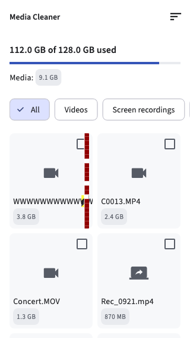
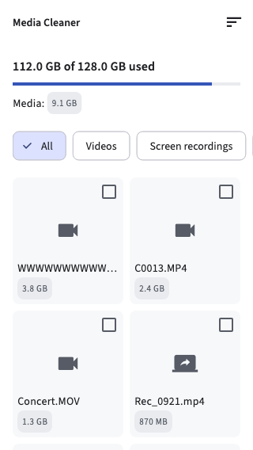
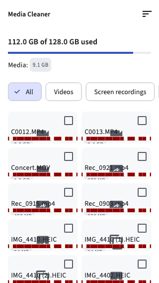
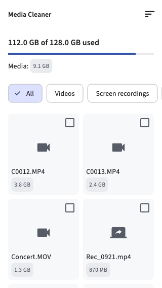
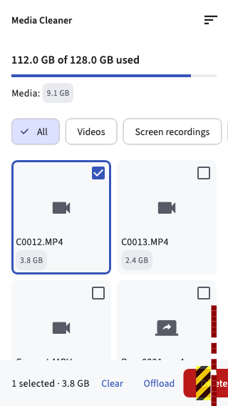
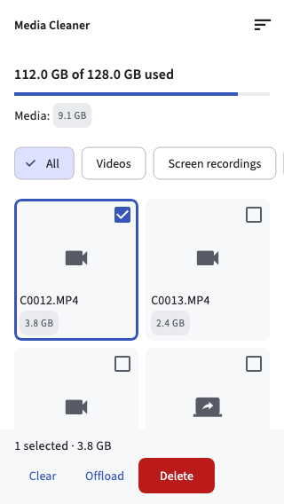

# H2 - constraint errors

These bugs show on the actual file-manager view in the emulator.

```sh
flutter run -d chrome -t lib/main_emulator.dart
```

Under H2 errors on the file manager, choose Filename width, Tile height, or Selection bar. Turn Show fix off to see the bug, then on to fix it. Off clears the H2 case.

You can change the device size and rotate it while the case is open. A wider screen can make the horizontal errors disappear because there is enough space. The short tiles still overflow because their height stays at 64 dp.

Use debug mode to see the overflow markers. The screenshots below come from Flutter widget tests at 320 × 568 dp, using the real MediaCleanerScreen with the app font and icons loaded. The error logs are saved beside them.

## 1. Filename width

Error: `A RenderFlex overflowed by 2123 pixels on the right.`

Rule broken: The Row lets the Text use its full width, so the 200-character filename becomes wider than the tile.

Broken:

```dart
Row(children: [Text(item.name)])
```

Fix: Put the name back in the tile's Column, where its width is limited, and use one line with ellipsis.

```dart
Text(item.name, maxLines: 1, overflow: TextOverflow.ellipsis)
```

The error is on the first tile. The Card cuts off the extra text, and the overflow marker shows at its edge.

Before:



After:



[Error log](screenshots/longName-error.txt)

## 2. Tile height

Error: `A RenderFlex overflowed by 22 pixels on the bottom.`

Rule broken: A 64 dp grid cell is too short for the tile's padding, checkbox, filename, and size label, even when the icon area shrinks.

Broken:

```dart
SliverGridDelegateWithFixedCrossAxisCount(
  crossAxisCount: 2,
  mainAxisExtent: 64,
)
```

Fix: Give the cells at least 160 dp of height so the contents fit.

```dart
SliverGridDelegateWithFixedCrossAxisCount(
  crossAxisCount: 2,
  mainAxisExtent: 160,
)
```

All visible tiles use the same short height, so the error repeats. Their size labels get cut off at the bottom.

Before:



After:



[Error log for one tile](screenshots/shortTile-error.txt)

## 3. Selection bar

Error: `A RenderFlex overflowed by 39 pixels on the right.`

Rule broken: The selection text and buttons need more width than the bottom bar has, and the Row cannot wrap them onto another line.

Broken:

```dart
Row(children: [summary, ...actions.children])
```

Fix: On a small phone, put the selection text above the wrapping buttons; on a wider screen, use Expanded so the text takes the space left beside the buttons.

```dart
if (constraints.maxWidth < 398) {
  return Column(
    mainAxisSize: MainAxisSize.min,
    crossAxisAlignment: CrossAxisAlignment.start,
    children: [summary, actions],
  );
}
return Row(children: [Expanded(child: summary), actions]);
```

This case selects the first file so the bottom bar shows immediately. The file stays selected when switching the fix on or off.

Before:



After:



[Error log](screenshots/actionRow-error.txt)

## Checks

```sh
flutter test test/constraints_test.dart
```

Six cases check that the broken layouts overflow and the fixed ones do not. Another test checks the emulator controls, all three sizes in portrait and landscape, keeping the selection, and switching H2 off.
