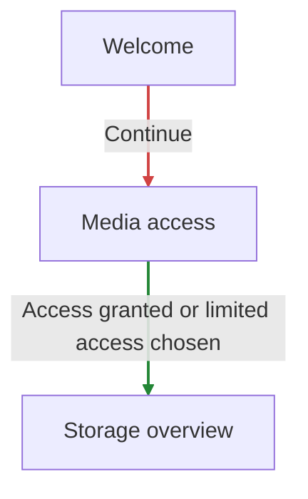
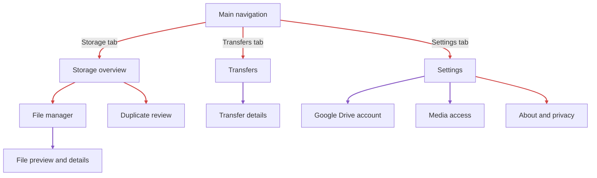
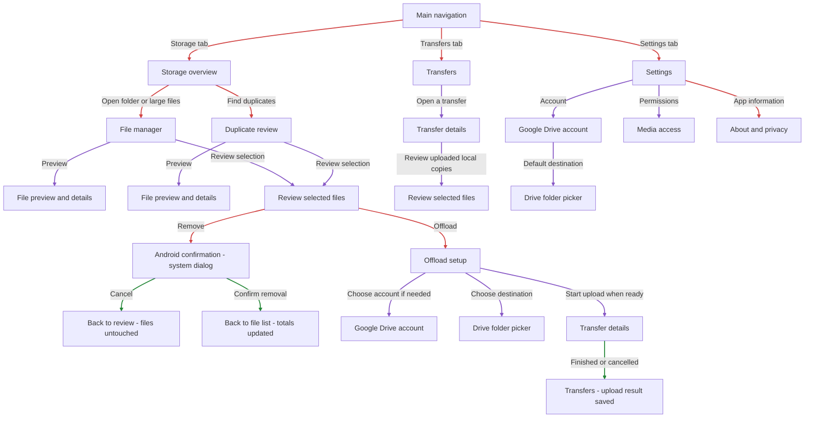
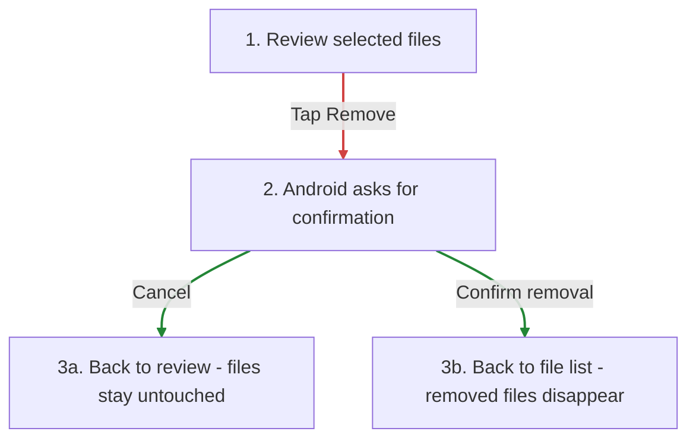
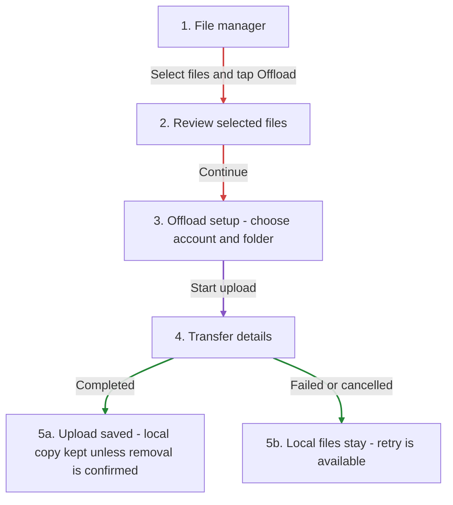
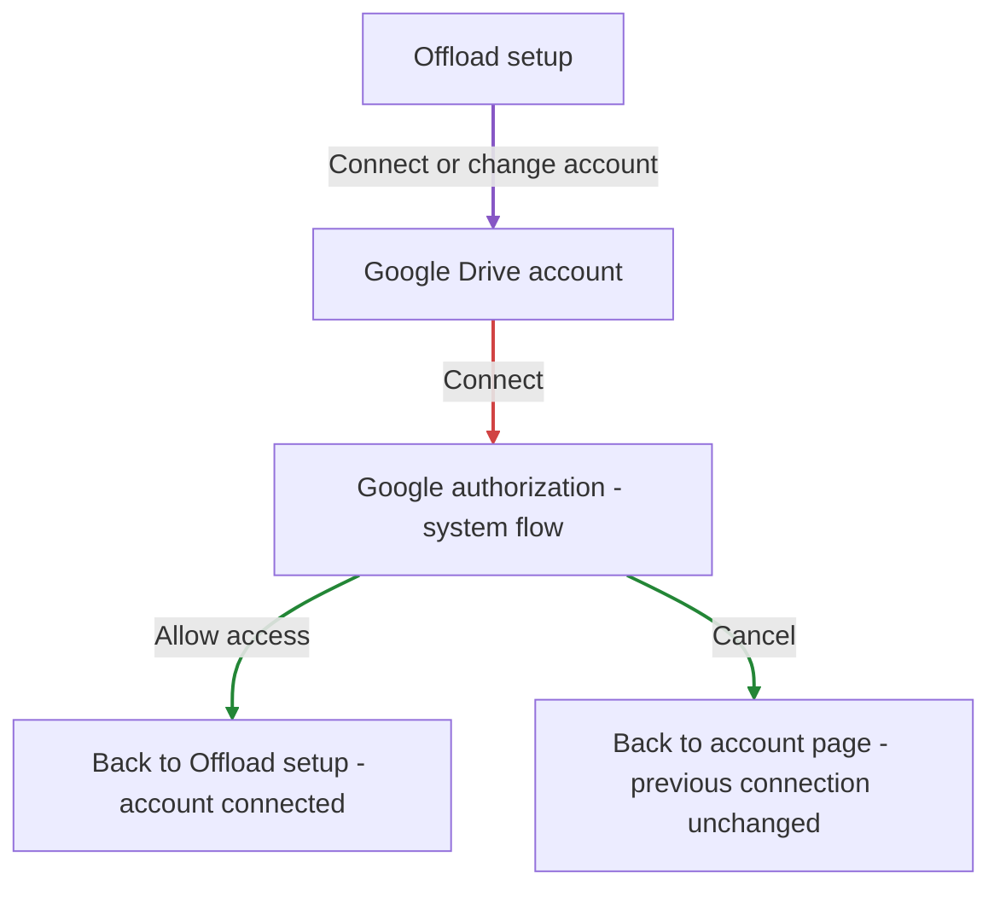
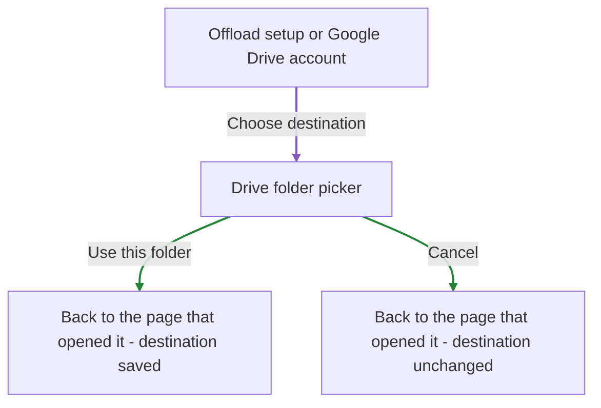

# H3 - app screen plan

This plan is for Android. This is the proposed map for the finished app, including screens that have not been built yet.

The app helps users see which media takes up space, review the files, and either remove them or upload them to their Google Drive. Local browsing and cleanup work without connecting Google Drive.

## Main navigation

Three main tabs:

- Storage: storage overview, folders, file review, and duplicates
- Transfers: uploads in progress and completed uploads
- Settings: Google Drive account, media access, and preferences

Storage overview and File manager already have mock layouts. Their storage access and cleanup actions are still demos. The other screens below are planned.

## Screen map

Start with the simple overview. The full map adds the other screens. The smaller flows below it explain each action.

Read every diagram from top to bottom. There are no looping or double-headed arrows.

Arrow colours:

- Red: the next action, such as opening files, continuing, or asking for confirmation.
- Green: the result after a choice or action, such as cancelling, connecting, or finishing an upload.
- Purple: opening a page that is reused elsewhere, such as File preview, Google Drive account, or Transfer details. Follow it in the arrow's direction just like a red arrow.

Colour explains the type of step. The arrowhead tells you where to go. Green does not mean incoming to a particular screen, and purple does not mean both directions.

Back normally returns to the page that opened the current screen. It is explained in the text instead of drawing an arrow back through the whole map. Boxes starting with Back to describe a return destination, not an extra screen.

### First launch

After setup, the app opens on Storage overview.

### Simple overview

Storage, Transfers, and Settings are the three main tabs. The pages below each one open when you tap something in that section.

### Full navigation map

The main route to each screen is shown here. A shared page can appear in more than one branch to keep the arrows from crossing the whole map. For example, the two Google Drive account boxes are the same page, opened from different places. Account connection and folder selection have their own flows below.

### Removing files

Start at Review selected files and follow the arrow down to Android confirmation. Then choose one of the two outcomes.

Cancel takes you back to review without changing the files. Confirmed removal takes you back to File manager or Duplicate review with updated files and totals.

### Offloading files

Choose the account and folder before starting. The two bottom boxes are upload outcomes, not new screens. Keep local files when an upload fails or is cancelled. A completed upload also keeps its local copy unless its removal was confirmed.

### Connecting Google Drive

When opened from Settings, the connected account page returns to Settings instead of Offload setup. Connecting an account does not start an upload.

### Choosing a Drive folder

The picker returns to the page that opened it. This can be Offload setup or the account page when choosing a default destination.

## Screens

| Screen | What it shows | Main actions |
| --- | --- | --- |
| 1. Welcome | What Media Cleaner does and how media access is used. Only shown on first launch. | Continue to media access. |
| 2. Media access | Current access, what the app can read, and what still needs permission. Reused from Settings. | Allow access, choose available media, open Android settings, or continue with limited access. |
| 3. Storage overview | Device used/free space, accessible media size, the bubble map, folder sizes, and last scan time. | Open a folder or category, review large files, review duplicates, or refresh. |
| 4. File manager | Files in the selected folder/category, thumbnails, filename search, size/date sorting, and multi-selection. | Preview a file, select files, clear selection, or review Delete/Offload. |
| 5. File preview and details | Photo/video preview, full name, size, date, location, and known upload status. | Select for review, open in another app, or go back. |
| 6. Duplicate review | Groups of exact duplicate files, with previews and their locations. | Pick which copies to keep and review the copies selected for removal. Nothing is selected for deletion automatically. |
| 7. Review selected files | The actual selected files, total size, and the chosen action. | Remove a file from the selection, confirm removal, continue to Offload setup, or go back. |
| 8. Offload setup | Selected files, total upload size, Google account, destination folder, and whether to keep local copies. | Connect/change account, choose a folder, and start uploading. Keep local copies is the default. |
| 9. Google Drive account | Connected account name/email, connection status, and default destination. Also has the disconnected state. | Connect, change account, disconnect, or choose the default folder. Returns to Settings or Offload setup depending on where it was opened. |
| 10. Drive folder picker | Folders the app is allowed to use, the current folder path, and a destination selection. | Open a folder, use it as the destination, or cancel. Reused for choosing a default folder in Settings. |
| 11. Transfers | Active, completed, failed, and cancelled uploads. Completed transfers also let users find files they offloaded. | Open a transfer, retry failed uploads, or open a completed upload in Drive. |
| 12. Transfer details | Progress, file-by-file results, account, destination, failures, and any confirmed local removal. | Cancel an active upload, retry failed files, open uploaded files in Drive, or review local copies after successful uploads. |
| 13. Settings | Theme, upload network preference, default local-copy behaviour, Google Drive account, media access, and app information. | Use System/Light/Dark theme, choose Wi-Fi-only uploads, and open the account/access/about pages. |
| 14. About and privacy | App version, what is stored locally, what is sent to Drive, and permission explanations. | Read the information and return to Settings. |

## States inside the screens

These are states of the same screen, so they do not need separate pages:

- Storage overview: scanning, ready, no accessible media, partial access, and scan error with Retry.
- File manager: a folder/category, search results, no files, no search results, and selection mode. Search/filter changes should not silently discard selected files.
- Duplicate review: scanning, groups found, and no duplicates found. Start with exact duplicates; similar photos can be a later feature.
- Google Drive account: disconnected, connected, cancelled connection, and connection expired with Reconnect.
- Drive folder picker: loading, available folders, empty folder, and access/loading error.
- Offload setup: missing account, missing destination, and ready to upload.
- Transfers/details: queued, uploading, waiting for network, completed, partially failed, failed, and cancelled. A completed upload can still have its local copy if removal was cancelled or failed.

Confirm removal and Cancel upload can use dialogs. Google supplies the account authorization flow. A separate Media Cleaner account is not needed for this plan.

## Main user flows

### Find and remove large files

Storage overview → Review large files → File manager → Select files → Review selected files → Android confirmation → Updated file list and storage totals.

### Offload to Google Drive

File manager → Select files → Review selected files → Offload setup → Connect account if needed → Choose destination → Start upload → Transfer details.

Leave local files untouched if an upload fails or is cancelled. Offer local removal only for files whose uploads completed and were checked. Local removal still needs its own confirmation, and its result is recorded separately from the upload result.

Google Drive supports resumable uploads, which fit the large media files this app handles. The progress and retry states should follow the actual upload result, not just bytes sent.

### Review duplicates

Storage overview → Duplicate review → Preview copies → Choose copies to keep/remove → Review selected files → Confirm removal.

### Change the account or preferences

Settings → Google Drive account / Media access / About and privacy → Back to Settings. Theme and upload preferences can stay directly on Settings.

## Phone and tablet layout

On phones, the main tabs use a bottom NavigationBar. On tablets, they use a NavigationRail at the side. The overview keeps its map/list split. File browsing can show the file list/grid beside the selected file's details; account and offload forms stay at a readable width rather than stretching across the screen.

The File manager search field is also where the real short-screen keyboard test can be checked once it is built.

## Android scope

The first version should browse accessible photos and videos using Android's supported media access. Device used/free space and the media the app can inspect are different totals; the overview must label them clearly. It should not claim to scan every app's private files or clear other apps' caches.

Google Drive access also depends on the permissions granted to the app. Prefer an app destination folder or a folder the user explicitly chooses, rather than promising access to their entire Drive.

## Build order

1. Add the main tabs and routes with mock data. Wire Settings and a mock Google Drive account page first.
2. Add File preview, Review selected files, and Offload setup with mock states.
3. Add real Android media access, scanning, and confirmed cleanup.
4. Connect Google Drive and the destination picker, then upload one file while keeping the local copy.
5. Add transfer history, progress, failed-file retries, and confirmed local removal after uploads.
6. Add exact duplicate detection.

References: [Android media access](https://developer.android.com/training/data-storage/shared/media), [Google authorization on Android](https://developer.android.com/identity/authorization), [Drive permissions](https://developers.google.com/workspace/drive/api/guides/api-specific-auth), [Drive uploads](https://developers.google.com/workspace/drive/api/guides/manage-uploads).
